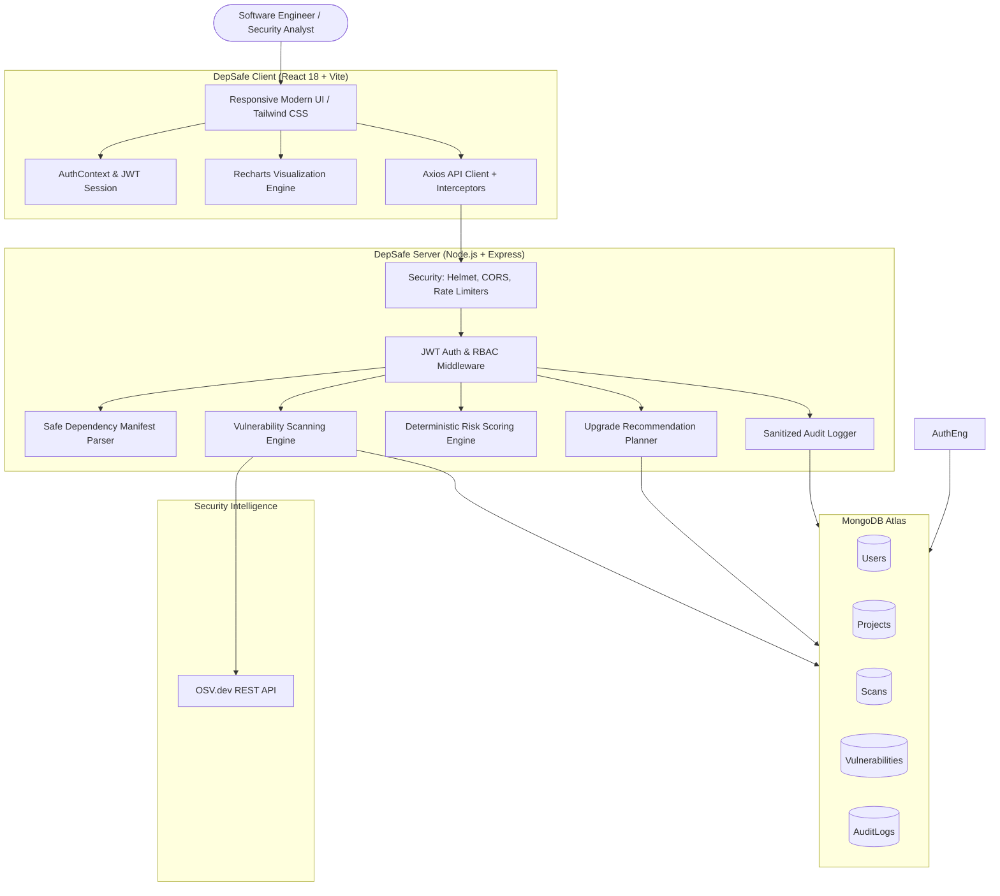

# DepSafe — Dependency Risk & Upgrade Planner

[](https://nodejs.org/)
[](https://react.dev/)
[](https://www.mongodb.com/atlas)
[](https://osv.dev/)
[](LICENSE)

**DepSafe** is a full-stack DevSecOps platform built with MongoDB, Express, React, and Node.js. It helps engineering teams identify vulnerable open-source dependencies across multiple ecosystems (`npm`, `PyPI`, `Maven`), understand real security exposure through deterministic risk scoring (0–100), and plan safe package upgrades.

---

## Architecture Diagram



---

## Key Features

1. **Multi-Ecosystem Manifest Support:**
   - `package.json` (npm declared ranges)
   - `package-lock.json` (npm v1/v2/v3 lockfiles with resolved trees)
   - `requirements.txt` (Python / PyPI pinned and unpinned packages)
   - `pom.xml` (Java / Maven dependencies with strict XXE protection)

2. **In-Memory Hardened Parsing:**
   - 1 MB file size limits.
   - Max 2,000 dependencies per project.
   - Strict rejection of `<!DOCTYPE>` and `<!ENTITY>` tags to eliminate XML External Entity (XXE) vulnerabilities.
   - Zero execution of user-submitted manifests or package install scripts.

3. **OSV API Integration:**
   - Upstream queries to `https://api.osv.dev/v1/query`.
   - Exponential backoff retry logic and 8,000ms request timeout control.
   - Deduplication and normalization of vulnerability advisories across ecosystems.

4. **Transparent Risk Scoring (0–100):**
   - Base CVSS v3 score fallback to qualitative severity mappings (Critical: 95, High: 80, Medium: 55, Low: 25).
   - Adjustments for direct dependencies (+5) and actionable fix availability (+5).
   - Documented in [`docs/SECURITY.md`](./docs/SECURITY.md).

5. **Actionable Upgrade Planner:**
   - Prioritizes remediations without inventing unreleased versions.
   - Clear warnings on compatibility and breaking changes.
   - Tracks remediation triage states (`open`, `in_progress`, `resolved`, `accepted_risk`).

6. **Enterprise Security & Compliance:**
   - `bcrypt` salted password hashing (configurable 12 rounds).
   - Short-lived JWT access tokens with active user validation.
   - Helmet HTTP security headers and CORS origin restrictions.
   - Sensitive credential scrubbing in audit logs.

---

## Monorepo Directory Structure

```text
dependency_risk_upgrade_planner/
├── client/                     # Frontend React + Vite application
│   ├── public/                 # Static assets
│   ├── src/
│   │   ├── components/         # Reusable common, layout, and chart components
│   │   │   ├── common/         # StatCard, Badge, Modal, LoadingSpinner
│   │   │   ├── layout/         # AppLayout, ProtectedRoute
│   │   │   └── charts/         # SeverityChart, RiskTrendChart (Recharts)
│   │   ├── context/            # AuthContext.jsx
│   │   ├── hooks/              # useAuth.js
│   │   ├── pages/              # Landing, Auth, Dashboard, Projects, Scans, Vulns, Planner, Audit, Settings
│   │   ├── services/           # api.js, authService, projectService, scanService, vulnerabilityService...
│   │   ├── utils/              # formatters.js, riskCalculator.js
│   │   ├── App.jsx             # Router configuration
│   │   ├── main.jsx            # Application entry
│   │   └── index.css           # Curated developer-tool design system
│   ├── package.json
│   └── vite.config.js
│
├── server/                     # Backend Node.js + Express API
│   ├── config/                 # Database and security configurations
│   ├── controllers/            # Request handlers (auth, project, scan, vuln, upgrade, dashboard, audit)
│   ├── middleware/             # authenticate, authorize, validateRequest, rateLimiter, errorHandler
│   ├── models/                 # User, Project, Scan, Vulnerability, AuditLog
│   ├── routes/                 # Express route definitions
│   ├── services/               # authService, tokenService, dependencyParser, osvService, scanService, upgradeService...
│   ├── validators/             # express-validator schemas (auth, project, scan)
│   ├── utils/                  # ApiError, asyncHandler, constants
│   ├── tests/                  # Automated node:test test suite
│   ├── app.js                  # Express app setup
│   └── server.js               # Entry point and graceful shutdown
│
├── docs/                       # Technical documentation
│   ├── ARCHITECTURE.md         # Monorepo architecture and topology
│   ├── API_DOCUMENTATION.md    # Complete REST API reference
│   ├── DATABASE_SCHEMA.md      # Mongoose schemas and ER diagram
│   ├── SECURITY.md             # Security controls & risk formula
│   └── SETUP.md                # Local setup and deployment
├── package.json                # Monorepo root scripts
└── README.md
```

---

## Quickstart

### 1. Install Dependencies
```bash
npm run install:all
```

### 2. Configure Environment Variables
Ensure `server/.env` contains your MongoDB Atlas connection string and JWT secret:
```env
PORT=5000
NODE_ENV=development
MONGODB_URI=mongodb+srv://<user>:<password>@<host>/<database>
JWT_SECRET=your_super_secret_jwt_key
BCRYPT_SALT_ROUNDS=12
CLIENT_URL=http://localhost:5173
```

### 3. Run Development Servers
Open two terminal windows:
```bash
# Terminal 1: Backend
npm run dev:server

# Terminal 2: Frontend
npm run dev --prefix client
```

### 4. Run Automated Tests
```bash
npm test
```

### 5. Build for Production
```bash
npm run build:client
```

---

## Detailed Documentation Links

- [System Architecture](docs/ARCHITECTURE.md)
- [REST API Reference](docs/API_DOCUMENTATION.md)
- [Database Schema & ERD](docs/DATABASE_SCHEMA.md)
- [Security Model & Risk Scoring Formula](docs/SECURITY.md)
- [Local Setup & Deployment Guide](docs/SETUP.md)
- [Interview & STAR Presentation Guide](docs/INTERVIEW_GUIDE.md)
- [Sharing with ChatGPT & Mock Interview Guide](docs/CHATGPT_CONTEXT.md)
